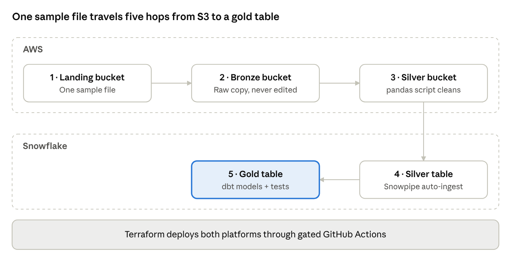

# Orders Medallion Pipeline — S3 → Lambda → Snowflake → dbt

An end-to-end batch data pipeline built with **spec-driven, human-in-the-loop AI engineering**. A human makes every product and architecture decision; an AI assistant does the execution (drafting specs, writing code, tests and infrastructure), and every stage passes a recorded human approval gate before the next one starts.



## What it does

| Step | Layer | Technology | Description |
|---|---|---|---|
| 1 | Landing | Amazon S3 | Raw order files arrive here |
| 2 | Bronze | Amazon S3 + AWS Lambda | Lambda copies the raw file untouched; bronze is the replayable source of truth |
| 3 | Silver | AWS Lambda (pandas) → S3 Parquet | Cleans, standardises, de-duplicates and rejects invalid rows |
| 4 | Silver | Snowflake (Snowpipe) | Auto-ingests silver Parquet files through a storage integration |
| 5 | Gold | Snowflake + dbt Core | Business-ready models with dbt tests |

All infrastructure on both AWS and Snowflake is defined in Terraform and deployed through a gated GitHub Actions pipeline.

## How it is built

The project follows the [BMAD](docs/README.md#delivery-process) lifecycle. Each stage produces a versioned artifact in [`docs/`](docs/) and ends at a human gate.

| Stage | Artifact | Status |
|---|---|---|
| 1. Brief | [Project brief](docs/01-brief/project-brief.md) | ✅ Approved (v1.1, 2026-11-04) |
| 2. PRD | [Product requirements](docs/02-prd/) | ⏳ Not started |
| 3. Architecture | [Architecture + ADRs](docs/03-architecture/) | 🟡 Decisions recorded as ADRs; design doc pending |
| 4. Development + unit tests | `src/`, `dbt/`, `tests/` | ⏳ Not started |
| 5. Deployment | `infra/`, `.github/workflows/` | 🟡 Pipeline scaffolded; Terraform pending |

## Repository layout

```text
.
├── .github/              CI/CD workflows, PR template, code owners
├── data/                 Sample dataset (synthetic) + data dictionary
├── dbt/                  dbt Core project: silver → gold models and tests
├── docs/                 BMAD artifacts, ADRs, runbooks, diagrams
│   ├── 01-brief/
│   ├── 02-prd/
│   ├── 03-architecture/  architecture doc + adr/
│   ├── 04-runbooks/
│   └── assets/
├── infra/                Terraform
│   ├── bootstrap/        one-time: remote state bucket + GitHub OIDC role
│   ├── modules/          reusable modules (storage, lambda, snowflake, budget)
│   └── live/             the deployed root module (single environment)
├── src/orders_pipeline/  Lambda source: bronze copy + pandas cleaning
├── tests/                unit and integration tests
├── Makefile              common local commands
└── pyproject.toml        Python package, tooling config
```

## Tech stack

Python 3.12 · pandas · pyarrow · AWS (S3, Lambda, IAM, Budgets) · Snowflake (Snowpipe, storage integration) · dbt Core · Terraform ≥ 1.10 · GitHub Actions (OIDC) · pytest · ruff · pre-commit

## Getting started

Prerequisites: Python 3.12, Terraform ≥ 1.10, AWS CLI v2, a Snowflake account, and `make`.

```bash
make setup     # create .venv, install package + dev tools, install pre-commit hooks
make lint      # ruff + terraform fmt check
make test      # pytest
make data      # regenerate data/sample_orders.csv (deterministic, seed 42)
```

## Deployment

Deployments run only through GitHub Actions:

1. **Pull request** → lint, unit tests, `terraform plan` (posted to the job summary).
2. **Merge to `main`** → a fresh plan, then `terraform apply` **waits for a required reviewer** on the `live` GitHub environment.
3. AWS access uses GitHub OIDC to assume a scoped IAM role — no long-lived keys are stored.

First-time setup (state bucket, OIDC role, GitHub environment and secrets) is described in [`infra/README.md`](infra/README.md) and [`docs/04-runbooks/`](docs/04-runbooks/).

## Cost

Designed to run inside AWS free-tier allowances and a minimal Snowflake footprint (X-Small warehouse, auto-suspend). A $5/month AWS Budgets alert is part of the infrastructure. See the brief's [constraints](docs/01-brief/project-brief.md#constraints).

## Contributing

See [CONTRIBUTING.md](CONTRIBUTING.md) for branching, commit conventions and the review gates.
