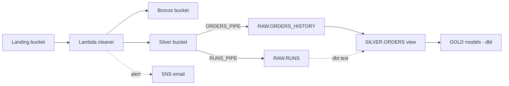
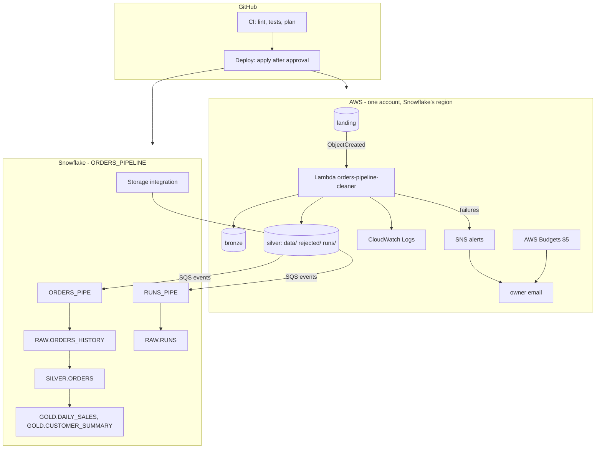

# Architecture Spine — Orders Medallion Pipeline

## Design Paradigm

**Event-driven pipes-and-filters over medallion layers.** Each stage is a filter that reads one layer and writes the next; data only flows forward; every hop is triggered by an object landing, never by a schedule.

| Layer | Where | Written by | Read by |
| --- | --- | --- | --- |
| Landing | S3 landing bucket | Uploader (owner) | Lambda cleaner |
| Bronze | S3 bronze bucket | Lambda cleaner (write-once) | Lambda cleaner (replay) |
| Silver files | S3 silver bucket `data/` | Lambda cleaner | Snowpipe `ORDERS_PIPE` |
| Rejected rows | S3 silver bucket `rejected/` | Lambda cleaner | Owner (S3 only in v1) |
| Run summaries | S3 silver bucket `runs/` + CloudWatch | Lambda cleaner | Snowpipe `RUNS_PIPE` |
| `RAW` | Snowflake schema | Snowpipe (loader role) | `SILVER` view, dbt tests |
| `SILVER` | Snowflake schema (views) | Terraform | dbt |
| `GOLD` | Snowflake schema | dbt | Analysts |

## Invariants & Rules



### AD-1 — Data flows forward only [ADOPTED]

- **Binds:** all
- **Prevents:** a later stage writing back into an earlier layer, or a layer reading from one downstream of it.
- **Rule:** Each component writes only to the layer(s) listed for it in the Design Paradigm table. No component modifies or deletes bronze. dbt reads `SILVER` (and `RAW.RUNS` for tests only) and writes only `GOLD`.

### AD-2 — One S3 bucket per layer

- **Binds:** FR-1, FR-2, FR-8, NFR-2; Terraform storage module; Lambda IAM
- **Prevents:** the Lambda re-triggering itself, and folder-level IAM mistakes.
- **Rule:** Landing, bronze and silver are separate buckets. The Lambda role can read landing, write to bronze only with a conditional create (`If-None-Match: *`) and never delete there, and write to silver. The Lambda never writes to the landing bucket. Snowflake's storage integration can read only the silver bucket. Only the Terraform deployer role may empty buckets (teardown, FR-21).

### AD-3 — Run identity is the shared key

- **Binds:** FR-7, FR-8, FR-9, FR-16, NFR-5; Lambda, S3 key layout, `RAW` tables, `SILVER` view, dbt tests
- **Prevents:** components disagreeing on how runs are named, ordered or joined.
- **Rule:** Every run gets `run_id = <UTC yyyymmddTHHMMSSZ>-<8 lowercase hex>` (lexically sortable by start time). Every bronze object, silver file, rejected file, run summary, `RAW` row and log line carries `run_id` and `source_file` (the landing object key). S3 keys follow the layout in the Structural Seed; no component invents another.

### AD-4 — One silver file per run, written last, only if reconciliation passes

- **Binds:** FR-7, FR-9, FR-10, NFR-3; Lambda writer; `SILVER` view
- **Prevents:** a failed or partial run becoming the "latest" data for a source file.
- **Rule:** The Lambda processes the whole source file in memory, checks `received = silver + rejected + duplicates`, and only then writes rejected rows, then exactly one silver Parquet object, then the run summary. A failed run writes its bronze copy (FR-2) and a `FAILED` run summary only — never a silver object.

### AD-5 — Reprocessing: append-only history, latest-run view

- **Binds:** FR-9, FR-11, FR-12; Snowpipe, `RAW.ORDERS_HISTORY`, `SILVER.ORDERS`, dbt sources
- **Prevents:** reprocessed files being silently skipped by Snowpipe's file-name load history, and double counting.
- **Rule:** Silver files are written under run-scoped keys, so every run produces a new object name. `ORDERS_PIPE` appends every silver file to `RAW.ORDERS_HISTORY`; nothing updates or deletes rows there. `SILVER.ORDERS` is a view returning, for each `source_file`, only the rows of its greatest `run_id`. dbt sources point at `SILVER.ORDERS`, never at `RAW.ORDERS_HISTORY`.

### AD-6 — The Lambda owns all cleaning; dbt owns only modelling [ADOPTED]

- **Binds:** FR-4 – FR-8, FR-13 – FR-15
- **Prevents:** the same data-quality rule implemented twice and drifting.
- **Rule:** Repairs, rejections and de-duplication live only in `src/orders_pipeline`. dbt models never filter, repair or de-duplicate silver data; they aggregate it. dbt tests may assert silver quality but never fix it.

### AD-7 — Run summary is a contract, verified in the warehouse

- **Binds:** FR-16, FR-17, SM-1; Lambda, `RUNS_PIPE`, `RAW.RUNS`, dbt tests
- **Prevents:** run counts that only the Lambda claims, and summary fields drifting between writer and readers.
- **Rule:** Every run writes one JSON summary with exactly the FR-16 fields (`run_id`, `source_file`, `started_at`, `ended_at`, `status`, `rows_received`, `rows_repaired`, `rows_rejected` by reason, `duplicates_removed`, `rows_silver`, `failure_reason`) to `runs/` and logs the same object to CloudWatch. `RUNS_PIPE` loads it into `RAW.RUNS`. A dbt test asserts that, for each run in `SILVER.ORDERS`, the row count equals `RAW.RUNS.rows_silver`. A field change updates writer, table and test in one pull request.

### AD-8 — Snowflake layout and access

- **Binds:** FR-11 – FR-15, FR-20, NFR-2; Terraform Snowflake module, dbt profile
- **Prevents:** reports built on internal tables, and roles with overlapping write access.
- **Rule:** One database, schemas `RAW`, `SILVER`, `GOLD`. Roles: `LOADER` owns the pipes and is the only role writing `RAW`; `TRANSFORMER` (dbt) reads `SILVER` and `RAW.RUNS`, writes `GOLD`; `ANALYST` reads `GOLD` only; `DEPLOYER` (Terraform service user) creates objects and grants. dbt runs on one X-Small `TRANSFORM_WH` (auto-suspend 60 s) usable only by `TRANSFORMER`; Snowpipe is serverless. Service users authenticate with key pairs.

### AD-9 — Every failure alerts; nothing retries automatically

- **Binds:** FR-17, NFR-3
- **Prevents:** silent failures, and retries creating surprise duplicate runs.
- **Rule:** Handled failures write a `FAILED` summary and publish to the SNS alert topic. Unhandled errors and timeouts reach the same topic through the Lambda's on-failure destination. Lambda asynchronous retries are set to 0; recovery is re-uploading the source file.

### AD-10 — No long-lived credentials anywhere [ADOPTED]

- **Binds:** FR-20, NFR-2
- **Prevents:** keys in code, CI or Lambda configuration.
- **Rule:** GitHub reaches AWS only through OIDC roles (`plan`, `deploy`). Snowflake reads S3 only through the storage integration's IAM role. The Lambda holds no Snowflake credentials. Snowflake service-user private keys live only in GitHub secrets.

### AD-11 — Terraform module ownership

- **Binds:** FR-18, FR-21; `infra/`
- **Prevents:** two modules managing the same resource — in particular overwriting a bucket's single notification configuration.
- **Rule:** `infra/live` composes modules `storage`, `lambda_cleaner`, `snowflake_ingest`, `alerting`, `budget`. Each resource has exactly one owning module. The landing bucket's notification belongs to `lambda_cleaner`; the silver bucket's notification (both `data/` and `runs/` prefixes, to Snowflake's queue) belongs to `snowflake_ingest`. Cross-provider values (storage integration IAM user ARN and external ID, Snowpipe queue ARN) are passed as module outputs, never typed by hand.

### AD-12 — One schema file per contract

- **Binds:** FR-7, FR-11, FR-16, AD-5, AD-7; Lambda writers, Terraform `RAW` table DDL, unit and dbt tests
- **Prevents:** the Parquet/JSON writer and the Snowflake table definition drifting apart, so loads fail or load NULLs.
- **Rule:** `schemas/silver_orders.json` and `schemas/run_summary.json` define column names, order and types. The Lambda builds its Arrow schema from them, Terraform creates `RAW.ORDERS_HISTORY` and `RAW.RUNS` from them (`jsondecode`), unit tests assert written files match them, and both pipes load with `MATCH_BY_COLUMN_NAME`. `loaded_at` is set by the pipe at load time. A schema change edits the file, never a copy.

## Consistency Conventions

| Concern | Convention |
| --- | --- |
| AWS names | `orders-pipeline-<component>`; buckets `orders-pipeline-<layer>-<account_id>` |
| Snowflake names | Upper-case identifiers: database `ORDERS_PIPELINE`, schemas `RAW`/`SILVER`/`GOLD`, roles as in AD-8 |
| Column names | `snake_case`, matching `data/README.md`; lineage columns `run_id`, `source_file`, `loaded_at` |
| Timestamps | UTC everywhere; ISO-8601 in JSON and logs; Parquet timestamps at microsecond precision, loaded as `TIMESTAMP_NTZ` |
| Money | `unit_price` and revenue as decimal(10,2) in Parquet, `NUMBER(10,2)` in Snowflake; never floats |
| Region | The AWS region equals the Snowflake account's AWS region |
| Rejection reasons | Fixed upper-snake codes from PRD FR-5; multiple reasons comma-joined in the order listed there |
| Logging | One JSON object per log line, always including `run_id` and `source_file` |
| Configuration | Lambda settings come from environment variables set by Terraform; no hard-coded names or ARNs in code |
| Tags | Every AWS resource: `project=orders-pipeline`, `managed_by=terraform`, `owner` |

## Stack

| Name | Version |
| --- | --- |
| Python (Lambda runtime and tooling) | 3.12 |
| pandas + pyarrow (AWS SDK for pandas managed layer) | `AWSSDKPandas-Python312`, layer version pinned in Terraform |
| Terraform | ~> 1.10 |
| hashicorp/aws provider | ~> 6.63 |
| snowflakedb/snowflake provider | ~> 2.20 |
| dbt-core / dbt-snowflake | ~> 1.12 |
| GitHub Actions | checkout v4, setup-python v5, setup-terraform v3, configure-aws-credentials v4 |

## Structural Seed



S3 key layout (AD-3):

```text
landing:  <source_file>                                    e.g. sample_orders.csv
bronze:   source=<source_file>/run_id=<run_id>/<source_file>
silver:   data/source=<source_file>/run_id=<run_id>/orders.parquet
          rejected/source=<source_file>/run_id=<run_id>/rejected.parquet
          runs/run_id=<run_id>.json
```

Source tree additions:

```text
schemas/              silver_orders.json, run_summary.json (AD-12)
src/orders_pipeline/   handler (S3 event -> run), cleaning rules, writers, run summary
tests/unit/            rule tests against data/sample_orders.csv (910 / 40 / 50)
dbt/models/gold/       daily_sales, customer_summary (+ schema tests)
dbt/tests/             run-count reconciliation test (AD-7)
infra/modules/         storage, lambda_cleaner, snowflake_ingest, alerting, budget
infra/live/            backend, providers, module wiring
```

## Capability → Architecture Map

| Capability / Area | Lives in | Governed by |
| --- | --- | --- |
| FR-1 – FR-3 ingestion, bronze | Lambda cleaner, landing/bronze buckets | AD-1, AD-2, AD-3 |
| FR-4 – FR-8 cleaning, rejection, de-dup | `src/orders_pipeline`, `schemas/` | AD-4, AD-6, AD-12 |
| FR-9, FR-10 reprocessing, reconciliation | Lambda writer, `SILVER.ORDERS` | AD-3, AD-4, AD-5 |
| FR-11, FR-12 Snowflake load | `ORDERS_PIPE`, `RAW.ORDERS_HISTORY`, `SILVER.ORDERS` | AD-5, AD-8 |
| FR-13 – FR-15 gold models and tests | `dbt/` | AD-6, AD-7, AD-8 |
| FR-16, FR-17 run summary, alerts | Lambda, `RUNS_PIPE`, `RAW.RUNS`, SNS | AD-7, AD-9 |
| FR-18 – FR-21 delivery, teardown | `infra/`, `.github/workflows/` | AD-10, AD-11 |
| NFR-1 cost | Budgets, Lambda timeout, X-Small auto-suspend warehouse | ADR-0009 |
| NFR-2 security | IAM, storage integration, OIDC | AD-2, AD-8, AD-10 |

## Deferred

- **More environments** — one `live` environment (ADR-0007); `infra/live` and modules allow a sibling environment later.
- **Scheduled `dbt build`** — manual in v1 (ADR-0008); moving it into GitHub Actions is a later ADR.
- **Rejected rows in Snowflake** — S3 only in v1 (PRD); add a third pipe if analysts need them.
- **Cross-file de-duplication** — out of scope (PRD FR-9); the latest-run view is per source file.
- **Retention and lifecycle rules** for bronze, silver history and run summaries — volumes are trivial in v1.
- **Customer-managed encryption keys and private networking** — S3 default encryption and public endpoints suffice at this data sensitivity; revisit with real data.
- **dbt v2 (Fusion engine)** — stay on the stable 1.x line until v2 adapters settle.
