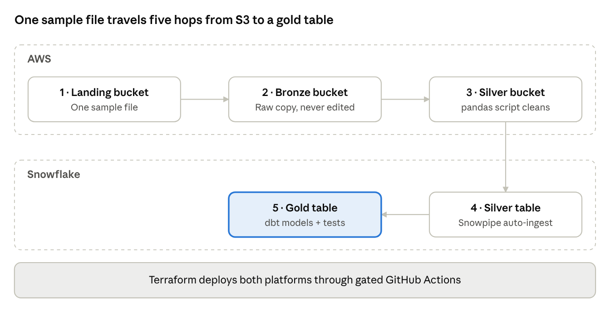

# Project brief — Spec-driven medallion pipeline (AWS + Snowflake + dbt)

**Version:** 1.1 · **Date:** 2026-11-04 · **Owner:** Jae · **Status:** Approved

## Review status

Final v1.1, approved by the project owner (Jae) on Nov 4, 2026, with every decision made. v1.1 adds gated CI/CD and remote Terraform state to scope. BMAD gate 1 is closed; next, the AI drafts the PRD from this brief.

Any change to this brief after approval goes through a new version and the owner's sign-off.

## Problem and goal

Build one small end-to-end medallion pipeline (S3 → Lambda → Snowflake → dbt) where a human makes every decision and AI does the execution. The data is deliberately trivial — one sample file — so the effort goes into the delivery process, not data volume.

The goal is a portfolio-grade proof of three skills interviewers probe at Staff level:

- **Spec-driven delivery** — every line of code traces back to an approved brief, PRD and architecture doc.
- **Human-in-the-loop AI engineering** — a clear, auditable split between what AI produces and what a human decides.
- **Cross-platform data engineering** — AWS storage and compute, Snowflake warehousing, dbt modelling, all provisioned with Terraform.

## Human-in-the-loop operating model

The human decides; the AI executes. Every architecture or system choice is made by the human, and each BMAD stage ends at a human gate before the next one starts.

| BMAD stage | AI executes | Human decides | Gate output |
| --- | --- | --- | --- |
| Brief | Drafts this document | Approves scope, goals, constraints | Approved brief |
| PRD | Drafts requirements and acceptance criteria | Approves requirements and priorities | Approved PRD |
| Architecture | Lays out options with trade-offs | Picks each option (load method, where the script runs, orchestration) | Architecture decision records |
| Development + unit tests | Writes pandas cleaning script, dbt models, tests | Reviews code and test results | Merged code, green tests |
| Terraform deployment | Writes Terraform, runs `plan` | Reviews the plan, approves `apply` | Provisioned infrastructure |

The AI never runs `terraform apply`, changes scope, or picks between architecture options on its own. If a gate is rejected, the AI revises that stage's artifact and resubmits it.

## Scope

v1 covers five steps across two platforms, plus the Terraform and tests that build them.

The file lands in S3, is copied raw to bronze, cleaned by a pandas script into silver, loaded into a Snowflake silver table, and modelled by dbt into gold.

**Out of scope for v1:** streaming or incremental loads, more than one source file, scheduled orchestration (Airflow, Step Functions), BI dashboards, multi-environment (dev/prod) deploys.

## Success criteria

v1 is done when all of these hold:

- [ ] One sample file flows landing → bronze → silver → Snowflake silver → gold with no manual data edits.
- [ ] Row counts reconcile at every hop: 1,000 bronze = 910 silver + 40 rejected + 50 duplicates removed.
- [ ] Unit tests (pytest) pass for the pandas cleaning logic; dbt tests pass on silver and gold.
- [ ] All infrastructure deploys through the gated GitHub Actions pipeline: created by `terraform apply` and removed by `terraform destroy`.
- [ ] Every BMAD artifact (brief, PRD, architecture, code, plan) has a recorded human approval.
- [ ] Total cloud spend for the build stays under the budget set in Constraints.

## Constraints

The main constraint is cost: about $120 of AWS credits remain (as of Nov 4, 2026), so the build stays on free tiers.

- **AWS account** — $120 of credits left on the new-customer free plan, which ends after 6 months or when credits run out ([AWS News Blog](https://aws.amazon.com/blogs/aws/aws-free-tier-update-new-customers-can-get-started-and-explore-aws-with-up-to-200-in-credits/)).
- **Guardrails in Terraform** — a Lambda timeout and an AWS Budgets alert ($5/month).
- **Snowflake** — one X-Small warehouse with auto-suspend, so it costs credits only while running.
- **Tooling** — Terraform, pandas + pytest for cleaning, dbt for silver → gold, AI coding assistant for all execution.

## Risks and assumptions

| Risk or assumption | Impact | Mitigation |
| --- | --- | --- |
| A Lambda function retries or loops | Unexpected bill | Lambda timeout + budget alert, both in Terraform |
| Cleaning rules split across the script and dbt | Same logic in two places, drift | Script owns cleaning; dbt owns modelling to gold (to confirm) |
| AI output accepted without real review | Gates become rubber stamps | Each gate records what was checked, not just "approved" |
| S3 → Snowflake access misconfigured | Load step fails | Storage integration + IAM role defined in Terraform, tested early |
| Assumption: one sample file is representative | Cleaning rules miss real-world mess | Seed the file with known bad rows on purpose |

## Decisions

The project owner made every decision below on Nov 4, 2026. Each one is expanded in an architecture decision record (ADR) under [`docs/03-architecture/adr/`](../03-architecture/adr/). They are fixed constraints for the PRD.

| Decision | Choice | Why |
| --- | --- | --- |
| Sample data | Synthetic CSV of 1,000 online orders with planted data-quality issues (`data/sample_orders.csv`) | Known answers to test against |
| Cleaning runtime | pandas script on AWS Lambda (AWS SDK for pandas layer); same code runs locally for tests | Always-free tier, no Glue cost |
| Landing → bronze | The Lambda copies the raw file to bronze untouched, then cleans bronze into silver | One function; bronze stays replayable |
| Silver file format | Parquet | Keeps cleaned types for Snowflake |
| Silver → Snowflake | Snowpipe auto-ingest through a storage integration | New files load automatically |
| Orchestration | S3 event triggers the Lambda, Snowpipe loads, dbt runs manually in v1 | No scheduler cost or setup |
| Terraform scope | AWS and Snowflake in one project | One place for the S3 ↔ Snowflake trust |
| Terraform state | S3 remote backend with native locking, created by a one-time bootstrap | Works from a laptop and from CI |
| CI/CD | GitHub Actions: pull requests run lint, tests and `terraform plan`; merges to main apply only after a required human approval; AWS access through OIDC, no stored keys | Enterprise-style deploys that keep the human gate |
| Environments | One environment | Cost and simplicity; the layout allows adding more later |
| Repository layout | Monorepo: `infra/`, `src/`, `dbt/`, `tests/`, `docs/`, `data/` | One place to review, version and deploy |
| Documentation standard | Every BMAD artifact and ADR is written for an outside engineer, not just the owner | The repo is a public, professional portfolio piece |
| dbt runtime | dbt Core, run locally in v1 | Free; easy to move to CI later |
| Budget alert | $5/month, alerts at 50% and 100%, measured before credits | Credits don't hide real spend |
