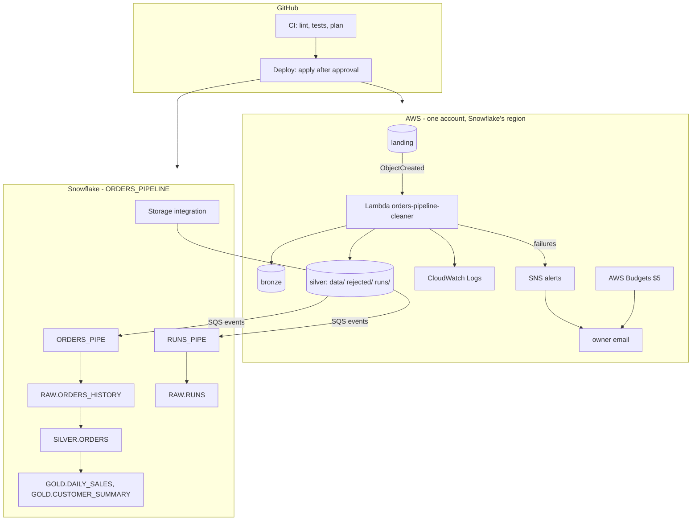

# Architecture overview

**Status:** Draft for owner approval · **Date:** 2026-11-16 · **Owner:** Jae

A readable walkthrough of how the pipeline works. The binding version — every rule implementers must follow — is the [architecture spine](architecture-spine.md); the reasons behind each choice are in the [ADRs](adr/).

## The whole system

## What happens to one file

1. **You upload** `sample_orders.csv` to the landing bucket. S3 invokes the cleaner Lambda; nothing is scheduled.
2. **Bronze first.** The Lambda gives the run an ID such as `20261116T153012Z-a1b2c3d4` and copies the file untouched to the bronze bucket, so the original bytes survive whatever happens next.
3. **Clean in memory.** It repairs what it can (status case, whitespace, `$` prices, US-style dates), rejects what it can't (40 rows, each with a reason), and keeps the latest version of each duplicated order (50 removed).
4. **Check before publishing.** Only if `1,000 = 910 + 40 + 50` does it write: rejected rows, then **one** silver Parquet file, then a run summary. A failed check writes only a `FAILED` summary and emails you.
5. **Snowflake loads itself.** Snowpipe sees the new silver file and appends it to `RAW.ORDERS_HISTORY`; a second pipe loads the run summary into `RAW.RUNS`. This takes about a minute.
6. **Analysts get gold.** You run `dbt build`: dbt reads `SILVER.ORDERS` (the latest run of each file), builds `GOLD.DAILY_SALES` and `GOLD.CUSTOMER_SUMMARY`, and tests that silver row counts match each run summary.

## What happens when…

| Situation | What the design does | Why |
| --- | --- | --- |
| The same file is uploaded again | A new run writes a new silver file; `SILVER.ORDERS` shows only the newest run, so totals stay 910 | Snowpipe never reloads a file name ([ADR-0010](adr/0010-reprocessing-run-scoped-history-latest-view.md)) |
| A run fails halfway | No silver file is written, so the previous run stays "latest"; you get an email | All-or-nothing publish ([ADR-0013](adr/0013-atomic-run-publish-and-run-summaries-in-snowflake.md)) |
| The Lambda crashes or times out | The failure goes to the same email alert; nothing retries on its own — re-upload to recover | Spine AD-9 |
| An analyst wants raw rows | Not in v1: analysts read gold only | [ADR-0012](adr/0012-snowflake-layout-gold-only-analyst-access.md) |
| Someone changes a column | The schema file in `schemas/` changes, and both the Lambda and the Snowflake table follow it in the same pull request | Spine AD-12 |

## Where things live

| Thing | Where |
| --- | --- |
| Raw uploads | S3 `orders-pipeline-landing-<account>` |
| Untouched copies | S3 `orders-pipeline-bronze-<account>` |
| Clean data, rejected rows, run summaries | S3 `orders-pipeline-silver-<account>` (`data/`, `rejected/`, `runs/`) |
| Load history | Snowflake `ORDERS_PIPELINE.RAW` |
| Clean orders (latest run) | Snowflake `ORDERS_PIPELINE.SILVER.ORDERS` |
| Analyst tables | Snowflake `ORDERS_PIPELINE.GOLD` |
